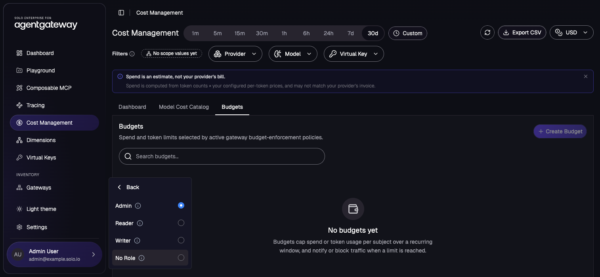
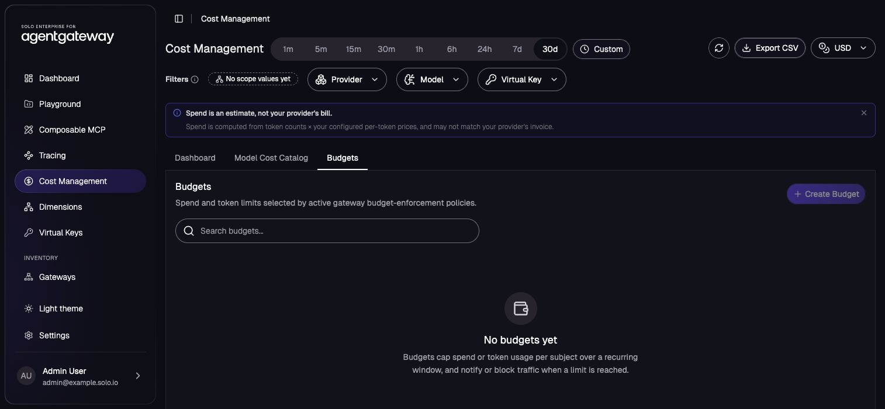
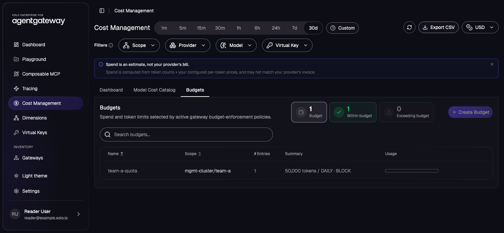
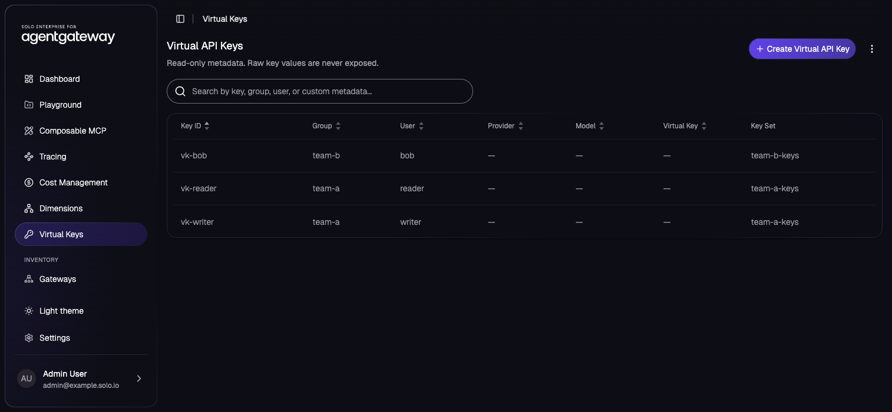
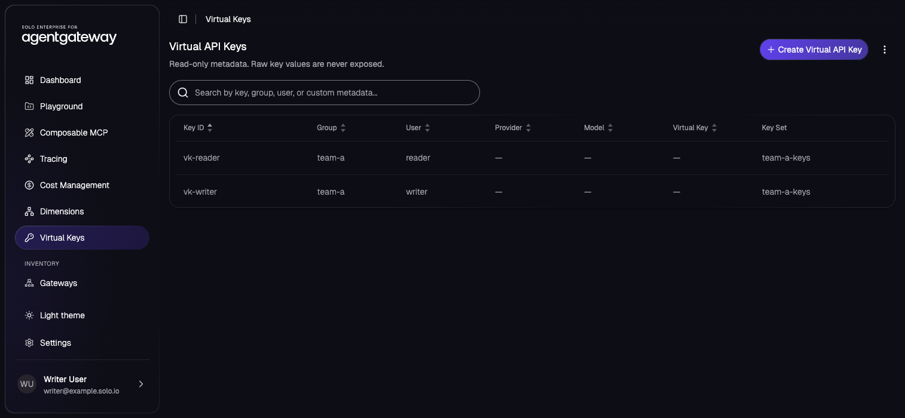
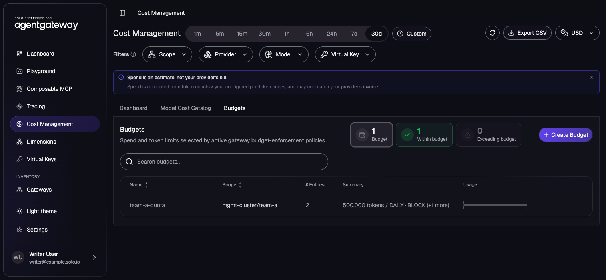
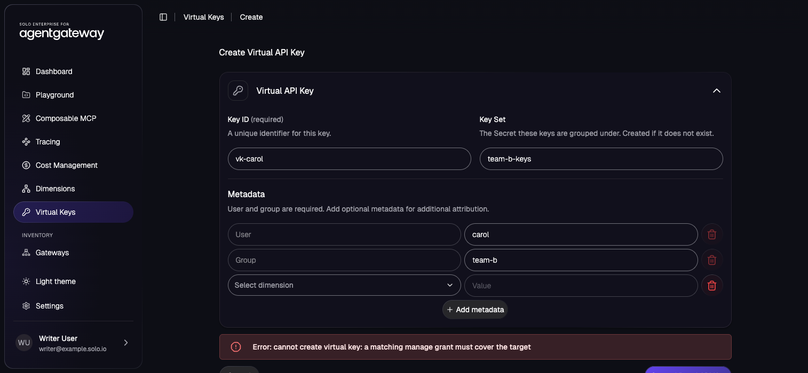

# Scope Solo UI Access per Team with Fine-Grained RBAC

## Pre-requisites
This lab assumes that you have completed the setup in `001` and `002`.

## Lab Objectives
- Switch the Solo UI from coarse roles to fine-grained RBAC
- Set up two team namespaces with budgets and virtual keys
- Review the access every user gets before any policy exists
- Grant a platform team full access and a team lead access to one namespace with `EnterpriseAgentgatewayRBACPolicy`
- Validate that the team lead cannot create a virtual key in another team's namespace

## Overview

By default, the Solo UI authorizes with three coarse roles: Admin, Writer, and Reader. A role applies to every resource the UI shows, so a Writer can edit any team's budgets and virtual keys. Fine-grained RBAC adds a per-resource check. You write `EnterpriseAgentgatewayRBACPolicy` resources that grant `view` or `manage` on budgets, virtual keys, and HTTPRoutes, and you scope each grant to namespaces, users, or budget subjects.

This lab signs in with the profiles built into the UI. [Use Your Identity Provider in Production](#use-your-identity-provider-in-production) covers an external OIDC provider. Each profile carries a group claim that maps to a coarse role:

| Profile | Groups claim | Coarse role | Plays in this lab |
| --- | --- | --- | --- |
| Admin | `admins` | `global.Admin` | Platform team: sees and manages everything |
| Writer | `writers` | `global.Writer` | Team A lead: manages Team A's budgets and virtual keys only |
| Reader | `readers` | `global.Reader` | Team A developer: sees only their own budget entry and virtual key |
| No Role | none | none | Denied |

The fine-grained check runs in addition to the coarse role check. A caller who maps to no coarse role still gets an access error, whatever their grants.

To switch profiles, open the account menu at the bottom of the sidebar (click the user name), then click **Change Role**. Reload the page after each switch so every view refetches with the new identity.



## Turn On Fine-Grained Mode

Upgrade the `enterprise-agentgateway` release in place:

```bash
export ENTERPRISE_AGW_VERSION=$(helm get metadata enterprise-agentgateway -n agentgateway-system | awk '/^VERSION:/ {print $2}')
helm upgrade enterprise-agentgateway oci://us-docker.pkg.dev/solo-public/enterprise-agentgateway/charts/enterprise-agentgateway \
  --namespace agentgateway-system \
  --version "$ENTERPRISE_AGW_VERSION" \
  --reuse-values \
  -f - <<EOF
ui:
  rbac:
    mode: fine-grained
EOF
kubectl rollout status deploy/enterprise-agentgateway-ui -n agentgateway-system
```

- `ui.rbac.mode: fine-grained` makes the UI backend evaluate `EnterpriseAgentgatewayRBACPolicy` grants on budget, virtual key, and HTTPRoute calls. The default, `coarse`, ignores those policies.
- With the built-in profiles, the UI identifies each user by the token's `sub` claim. With an external OIDC provider, `ui.rbac.subjectMapping.userClaim` names the claim instead (default `preferred_username`); see [Use Your Identity Provider in Production](#use-your-identity-provider-in-production).

Port-forward the UI if it is not already open, and browse to `http://localhost:4000`:

```bash
kubectl port-forward -n agentgateway-system svc/enterprise-agentgateway-ui 4000:80
```

## Create Two Team Namespaces

Each team gets a namespace with an HTTPRoute, a Secret of virtual keys, the API key policy that makes those keys usable, and a token budget. The Team A keys belong to the `writer` and `reader` users, so each virtual key's `user` matches the user ID of a UI profile:

```bash
kubectl apply -f - <<EOF
apiVersion: v1
kind: Namespace
metadata:
  name: team-a
---
apiVersion: v1
kind: Namespace
metadata:
  name: team-b
---
apiVersion: gateway.networking.k8s.io/v1
kind: HTTPRoute
metadata:
  name: team-a-llm
  namespace: team-a
spec:
  parentRefs:
  - name: agentgateway-proxy
    namespace: agentgateway-system
  rules:
  - matches:
    - path:
        type: PathPrefix
        value: /team-a
---
apiVersion: gateway.networking.k8s.io/v1
kind: HTTPRoute
metadata:
  name: team-b-llm
  namespace: team-b
spec:
  parentRefs:
  - name: agentgateway-proxy
    namespace: agentgateway-system
  rules:
  - matches:
    - path:
        type: PathPrefix
        value: /team-b
---
apiVersion: v1
kind: Secret
metadata:
  name: team-a-keys
  namespace: team-a
  labels:
    app: llm-virtual-keys
type: Opaque
stringData:
  writer: |
    {
      "key": "sk-team-a-writer-demo",
      "metadata": {
        "id": "vk-writer",
        "user": "writer",
        "group": "team-a"
      }
    }
  reader: |
    {
      "key": "sk-team-a-reader-demo",
      "metadata": {
        "id": "vk-reader",
        "user": "reader",
        "group": "team-a"
      }
    }
---
apiVersion: v1
kind: Secret
metadata:
  name: team-b-keys
  namespace: team-b
  labels:
    app: llm-virtual-keys
type: Opaque
stringData:
  bob: |
    {
      "key": "sk-team-b-bob-demo",
      "metadata": {
        "id": "vk-bob",
        "user": "bob",
        "group": "team-b"
      }
    }
---
apiVersion: enterpriseagentgateway.solo.io/v1alpha1
kind: EnterpriseAgentgatewayPolicy
metadata:
  name: team-a-api-keys
  namespace: team-a
spec:
  targetRefs:
  - group: gateway.networking.k8s.io
    kind: HTTPRoute
    name: team-a-llm
  traffic:
    apiKeyAuthentication:
      mode: Strict
      secretSelector:
        matchLabels:
          app: llm-virtual-keys
---
apiVersion: enterpriseagentgateway.solo.io/v1alpha1
kind: EnterpriseAgentgatewayPolicy
metadata:
  name: team-b-api-keys
  namespace: team-b
spec:
  targetRefs:
  - group: gateway.networking.k8s.io
    kind: HTTPRoute
    name: team-b-llm
  traffic:
    apiKeyAuthentication:
      mode: Strict
      secretSelector:
        matchLabels:
          app: llm-virtual-keys
---
apiVersion: enterpriseagentgateway.solo.io/v1alpha1
kind: EnterpriseAgentgatewayBudget
metadata:
  name: team-a-quota
  namespace: team-a
spec:
  budgets:
  - name: team-a-daily-tokens
    subject:
      group: team-a
    limit:
      unit: Tokens
      amount: 500000
    window:
      unit: Day
    onBudgetExceeded: Block
  - name: reader-daily-tokens
    subject:
      user: reader
    limit:
      unit: Tokens
      amount: 50000
    window:
      unit: Day
    onBudgetExceeded: Block
---
apiVersion: enterpriseagentgateway.solo.io/v1alpha1
kind: EnterpriseAgentgatewayBudget
metadata:
  name: team-b-quota
  namespace: team-b
spec:
  budgets:
  - name: team-b-daily-tokens
    subject:
      group: team-b
    limit:
      unit: Tokens
      amount: 500000
    window:
      unit: Day
    onBudgetExceeded: Block
---
apiVersion: enterpriseagentgateway.solo.io/v1alpha1
kind: EnterpriseAgentgatewayPolicy
metadata:
  name: budget-enforcement
  namespace: agentgateway-system
spec:
  targetRefs:
  - group: gateway.networking.k8s.io
    kind: Gateway
    name: agentgateway-proxy
  traffic:
    entBudgetEnforcement:
      discovery:
        namespaces:
          from: All
EOF
```

The `budget-enforcement` policy makes the gateway enforce budgets from every namespace. The UI's **Budgets** tab lists only budgets that an enforcement policy selects, so without it the tab stays empty for every user.

Check that both budgets are enforced:

```bash
kubectl get enterpriseagentgatewaybudget -A
```

Expected output:

```
NAMESPACE   NAME           ACCEPTED   ENFORCED   AGE
team-a      team-a-quota   True       True       10s
team-b      team-b-quota   True       True       10s
```

## Review the Default Access

Before any policy exists, each caller gets these defaults:

| Resource | Default access |
| --- | --- |
| Budgets | `view` on entries whose `subject.user` is the caller, or whose `subject.group` is one of the caller's groups |
| Virtual keys | `manage` on keys whose `user` is the caller |
| HTTPRoutes | None |

Switch through the profiles and open **Cost Management** > **Budgets**, then **Virtual Keys** in the sidebar:

- As Admin, both pages are empty. `global.Admin` gets no fine-grained access until a policy grants it.

  

- As Writer, **Virtual Keys** shows only `vk-writer`.
- As Reader, **Virtual Keys** shows only `vk-reader`, and **Budgets** shows `team-a-quota` with one entry, `reader-daily-tokens`: the entry that names the reader. The `team-a-daily-tokens` entry stays hidden.

  

## Grant Access with RBAC Policies

Grant the platform team access to everything, and the Team A lead `manage` on Team A's namespace only:

```bash
kubectl apply -f - <<EOF
apiVersion: enterpriseagentgateway.solo.io/v1alpha1
kind: EnterpriseAgentgatewayRBACPolicy
metadata:
  name: platform-admins
  namespace: agentgateway-system
spec:
  principals:
  - all:
    - attribute: groups
      values:
      - admins
  grants:
  - name: manage-budgets
    accessLevel: manage
    resource: agentgateway:budgets
  - name: manage-virtual-keys
    accessLevel: manage
    resource: agentgateway:virtual-keys
  - name: view-httproutes
    accessLevel: view
    resource: agentgateway:httproutes
---
apiVersion: enterpriseagentgateway.solo.io/v1alpha1
kind: EnterpriseAgentgatewayRBACPolicy
metadata:
  name: team-a-leads
  namespace: agentgateway-system
spec:
  principals:
  - all:
    - attribute: groups
      values:
      - writers
  grants:
  - name: manage-team-a-budgets
    accessLevel: manage
    resource: agentgateway:budgets
    constraints:
    - all:
      - attribute: namespace
        values:
        - team-a
  - name: manage-team-a-virtual-keys
    accessLevel: manage
    resource: agentgateway:virtual-keys
    constraints:
    - all:
      - attribute: namespace
        values:
        - team-a
  - name: view-team-a-httproutes
    accessLevel: view
    resource: agentgateway:httproutes
    constraints:
    - all:
      - attribute: namespace
        values:
        - team-a
EOF
kubectl get enterpriseagentgatewayrbacpolicy -n agentgateway-system
```

Expected output:

```
NAME              ACCEPTED   REASON     AGE
platform-admins   True       Accepted   1s
team-a-leads      True       Accepted   1s
```

- `principals` selects callers. Entries are ORed, and the conditions inside one `all` are ANDed. Use `groups` to match the groups claim and `user` to match the user claim.
- `grants` are additive across every policy that matches a caller, and they add to the defaults above. `manage` includes `view`.
- `constraints` narrow a grant. Without them, the grant covers the resource in every namespace.
- HTTPRoutes support `view` only. Budget entries (`agentgateway:budgets:entries`) also support `view` only, and you can constrain them by `budgetResourceName` or by `subject.<key>` (for example `subject.group`).
- A policy applies across every namespace the UI watches, whichever namespace it lives in.

The policies take effect immediately. Reload the UI under each profile:

| Profile | Budgets | Virtual Keys | Routes |
| --- | --- | --- | --- |
| Admin | `team-a-quota`, `team-b-quota` | `vk-writer`, `vk-reader`, `vk-bob` | `team-a-llm`, `team-b-llm` |
| Writer | `team-a-quota` (both entries) | `vk-writer`, `vk-reader` | `team-a-llm` |
| Reader | `team-a-quota` (its own entry only); **Create Budget** is disabled | `vk-reader` | None |

The Admin now sees both teams' keys:



The Writer sees Team A only:





## Try to Write Outside the Team's Namespace

As Writer, open **Virtual Keys** and click **Create Virtual API Key**. Enter:

- **Key ID**: `vk-carol`
- **Key Set**: `team-b-keys`
- **User**: `carol`
- **Group**: `team-b`

The UI rejects the request:

```
Error: cannot create virtual key: a matching manage grant must cover the target
```



Change **Key Set** to `team-a-keys` and **Group** to `team-a`, then submit again. The UI creates the key in `team-a` and shows the raw key once. Confirm that it landed in the Team A Secret:

```bash
kubectl get secret team-a-keys -n team-a -o jsonpath='{.data}' | jq -r 'keys[]'
```

Expected output:

```
reader
vk-carol
writer
```

## Use Your Identity Provider in Production

The built-in profiles are for demos. In production, point the UI at your OIDC provider (see [Expose the UI via HTTPS](https://docs.solo.io/agentgateway/latest/install/ui/https/) for the client setup) and map its groups to coarse roles. A user needs a coarse role to load the UI; fine-grained policies then scope what they see:

```yaml
ui:
  oidc:
    issuer: https://idp.example.com/realms/example
  backend:
    oidc:
      secretRef: ui-backend-oidc-secret
  rbac:
    mode: fine-grained
    subjectMapping:
      userClaim: preferred_username
      groupsClaim: Groups
    roleMapping:
      roleMappings:
        platform-team: global.Admin
        team-a: global.Reader
        team-b: global.Reader
```

Then write policy `principals` against your real groups (for example `groups: team-a`) and keep virtual key `user` metadata equal to each user's `preferred_username`, so the owner default applies.

## Cleanup

Remove the demo resources and return the UI to coarse mode. Other labs assume coarse mode: in fine-grained mode with no `platform-admins` policy, the Admin profile sees no budgets or virtual keys.

```bash
kubectl delete enterpriseagentgatewayrbacpolicy platform-admins team-a-leads -n agentgateway-system --ignore-not-found
kubectl delete enterpriseagentgatewaypolicy budget-enforcement -n agentgateway-system --ignore-not-found
kubectl delete namespace team-a team-b --ignore-not-found
export ENTERPRISE_AGW_VERSION=$(helm get metadata enterprise-agentgateway -n agentgateway-system | awk '/^VERSION:/ {print $2}')
helm upgrade enterprise-agentgateway oci://us-docker.pkg.dev/solo-public/enterprise-agentgateway/charts/enterprise-agentgateway \
  --namespace agentgateway-system \
  --version "$ENTERPRISE_AGW_VERSION" \
  --reuse-values \
  -f - <<EOF
ui:
  rbac:
    mode: coarse
EOF
kubectl rollout status deploy/enterprise-agentgateway-ui -n agentgateway-system
```
